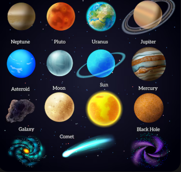
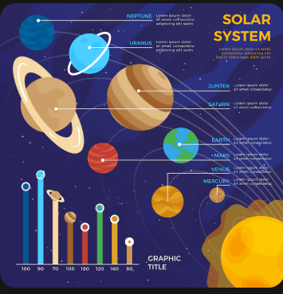
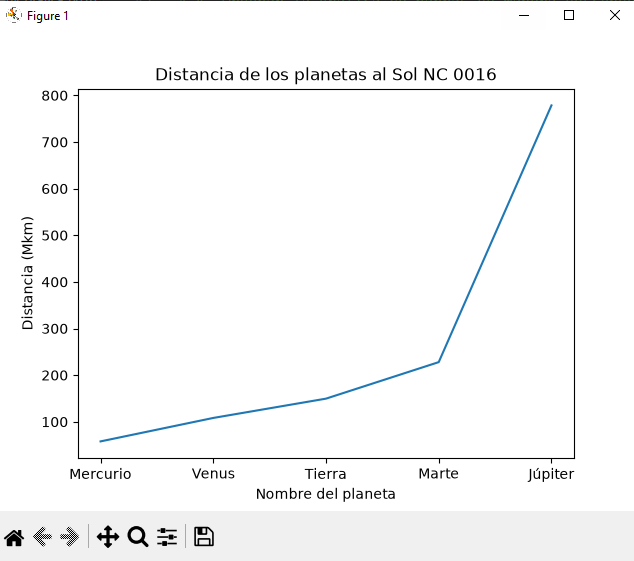
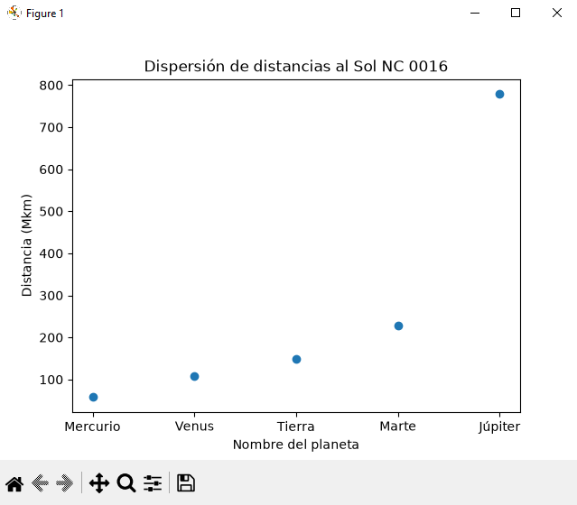
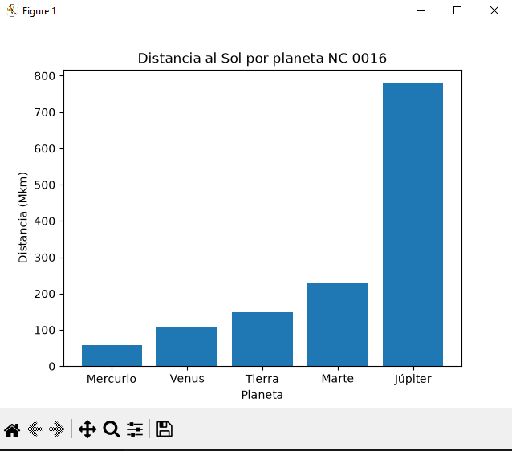
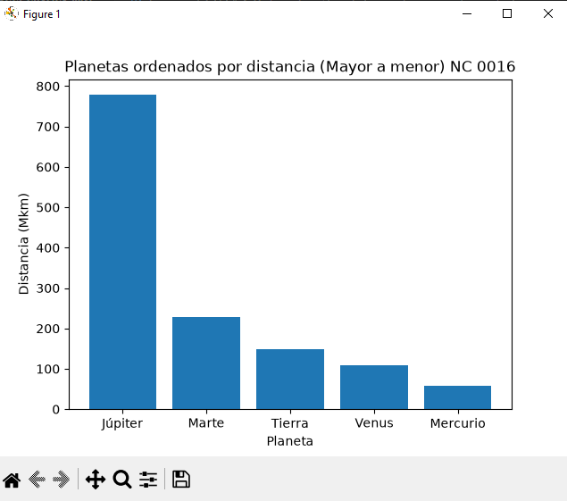
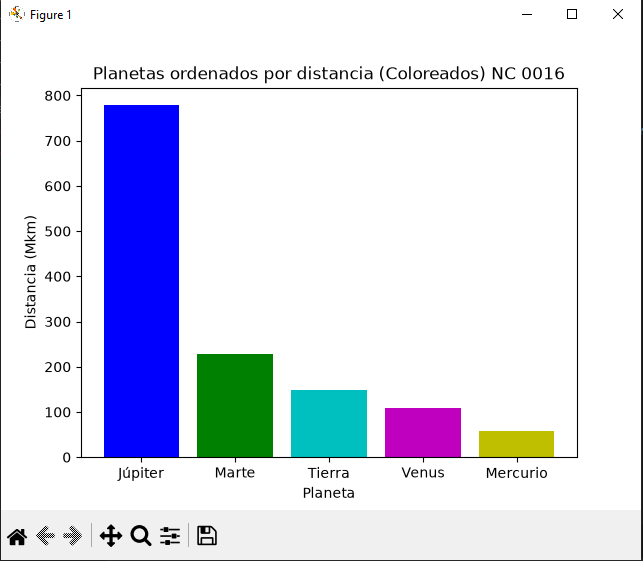
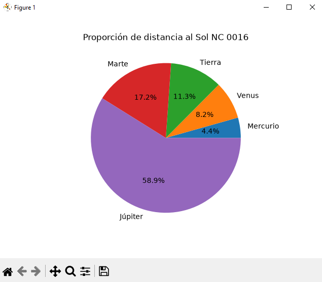

# Sistemas solares grafica

# 1. Gráfica de líneas

# 2. Gráfica de dispersión (Scatter)

# 3. Gráfica de barras

# 4. Ordenar la gráfica de barras de manera descendente

# 5. Coloreando la gráfica de barras (5 colores para los 5 planetas)

# 6. Gráfica de pastel
